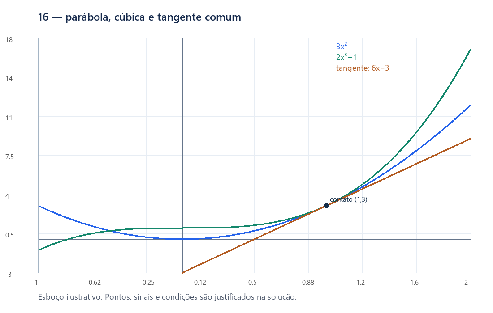
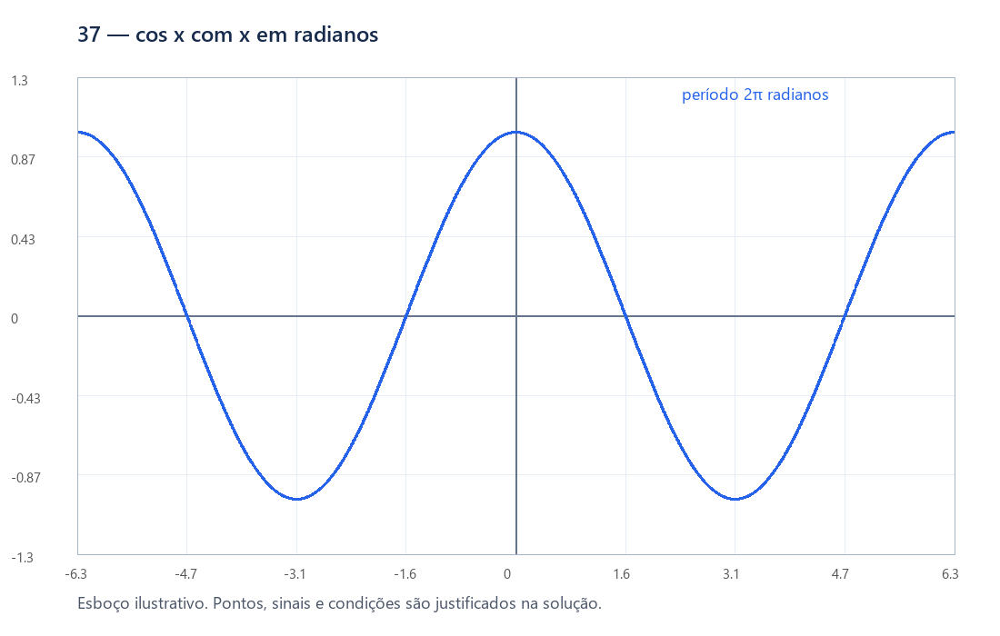
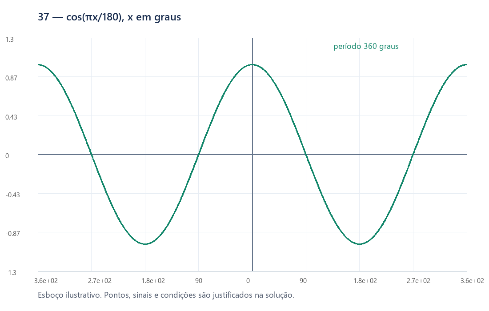
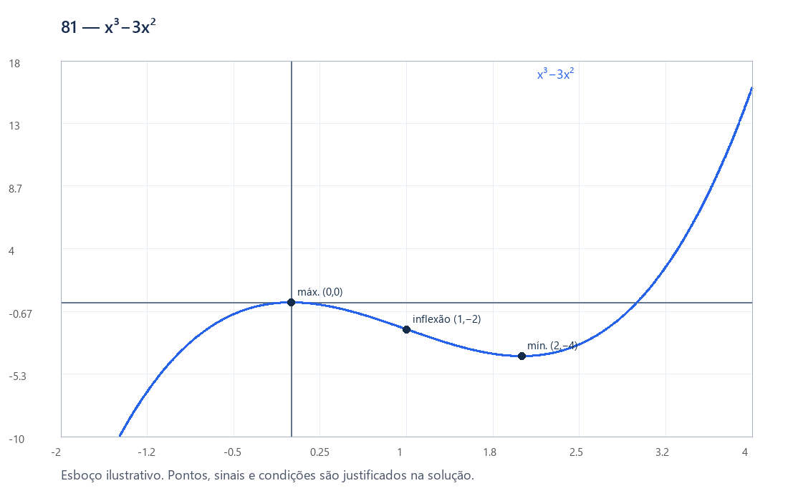
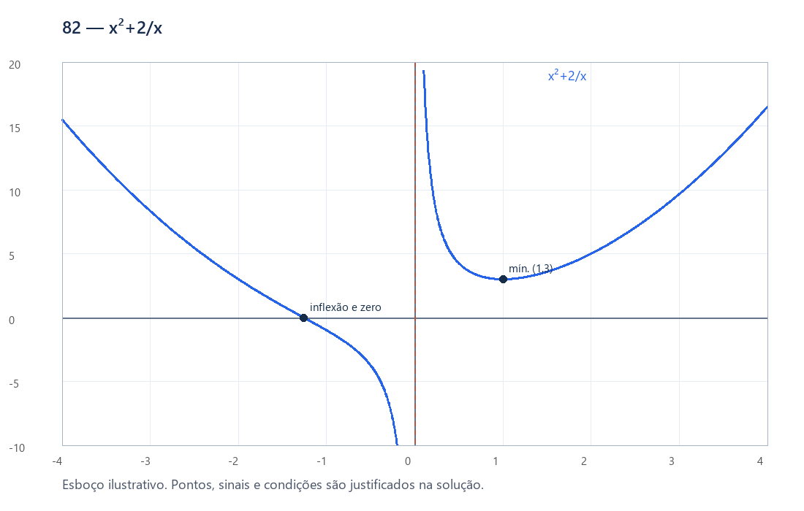
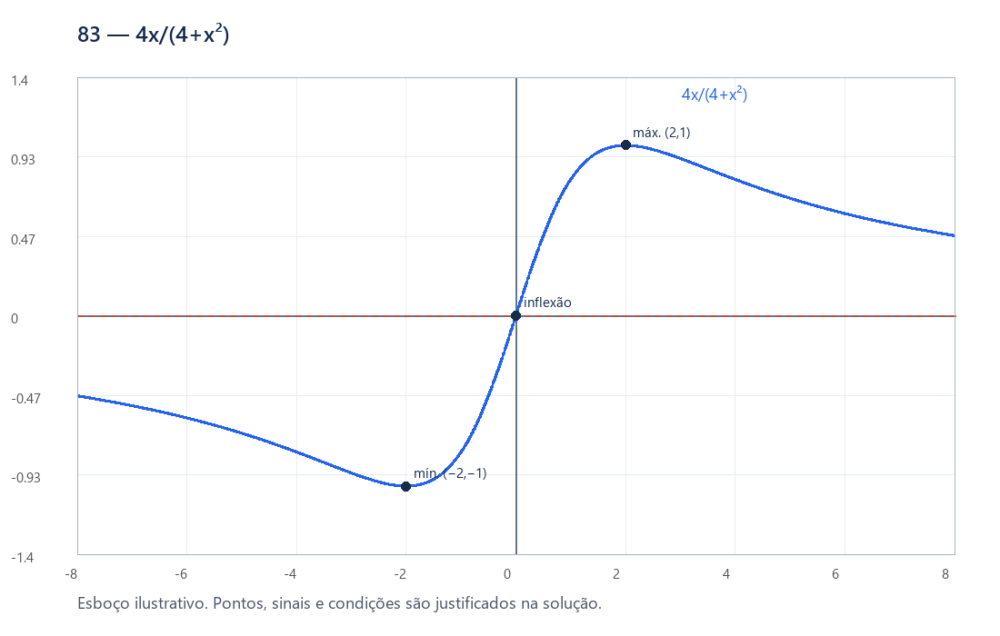
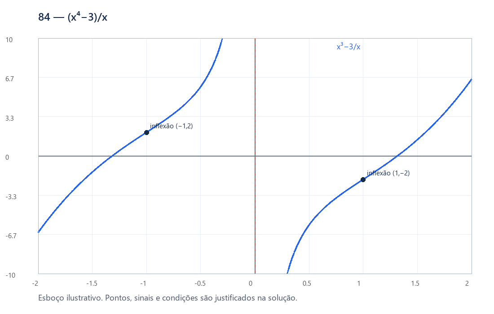
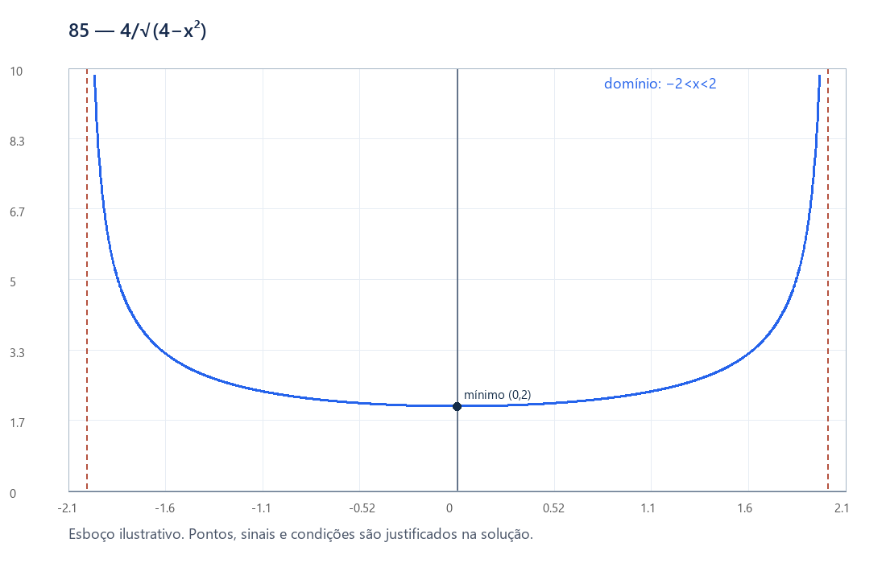
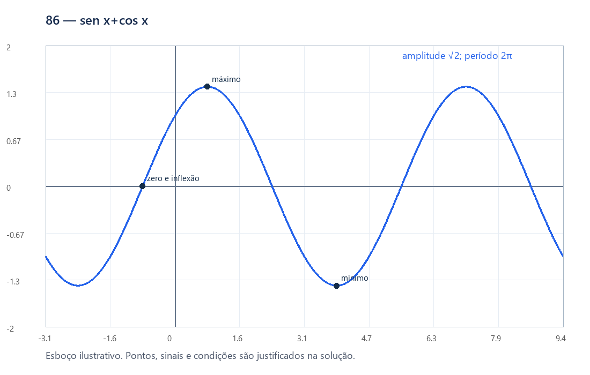

# Deriva — gabaritos e soluções

Arquivo de consulta após tentativa. Há uma resolução completa por exercício; enunciados ficam separados. Revisão matemática pelo autor, com verificações simbólicas complementares documentadas.

## DER-L3-001

Resposta: $f'(x)=9x^2+8x$.

1. A derivada de 3x³ é 9x²; a de 4x² é 8x; a constante desaparece.
2. Somando, f′=9x²+8x.

Condições e observações: Domínio de validade da fórmula derivada: R.

## DER-L3-002

Resposta: $f'(x)=2x\csc x-x^2\csc x\cot x$.

1. Produto: (x²)′csc x+x²(csc x)′.
2. Use (csc x)′=−csc x cot x e reúna os termos.

Condições e observações: Domínio de validade da fórmula derivada: x∉πZ.

## DER-L3-003

Resposta: $h\prime(t)=3t^2+2/t^3$.

1. Reescreva a fração como potência negativa.
2. (−t⁻²)′=+2t⁻³: o sinal negativo é multiplicado por −2.

Condições e observações: Domínio de validade da fórmula derivada: t≠0.

## DER-L3-004

Resposta: $f'(x)=-2\cos x\sin x\cot x-\cos^2x\csc^2x$.

1. Produto: derive cos²x e cot x separadamente.
2. (cos²x)′=−2cos x sen x; cot′x=−csc²x.
3. Substitua na regra do produto.

Condições e observações: Domínio de validade da fórmula derivada: x∉πZ.

## DER-L3-005

Resposta: $r\prime(s)=2\sec^2s\tan s+\tan s+s\sec^2s$.

1. Cadeia: (sec²s)′=2sec s·sec s tan s.
2. Produto: (s tan s)′=tan s+s sec²s.
3. Some as duas expressões.

Condições e observações: Domínio de validade da fórmula derivada: cos s≠0.

## DER-L3-006

Resposta: $f'(x)=-15(3x)^{-6}$.

1. Ponha u=3x. A derivada externa é −5u⁻⁶.
2. Multiplique por u′=3.

Condições e observações: Domínio de validade da fórmula derivada: x≠0.

## DER-L3-007

Resposta: $f'(x)=\frac{\operatorname{arcsec}x-x/(|x|\sqrt{x^2-1})}{(\operatorname{arcsec}x)^2}$.

1. Use quociente: [arcsec x−x(arcsec x)′]/(arcsec x)².
2. Insira (arcsec x)′=1/(|x|√(x²−1)).
3. Não cancele o módulo substituindo |x| por x para x<−1.

Condições e observações: Domínio de validade da fórmula derivada: |x|>1. A função também está definida em x=−1, mas ali não tem derivada finita; x=1 é excluído pois arcsec 1=0.

## DER-L3-008

Resposta: $f'(x)=\frac{2\sin x}{\cos^3x}+\frac{4\sin^3x}{\cos^5x}$.

1. No domínio original, sec²x/cot²x=sen²x/cos⁴x.
2. Derive sen²x cos⁻⁴x por produto e cadeia.
3. Obtenha 2sen x/cos³x+4sen³x/cos⁵x. A simplificação não restaura os zeros do seno.

Condições e observações: Domínio de validade da fórmula derivada: sen x≠0 e cos x≠0.

## DER-L3-009

Resposta: $f'(x)=-\frac{3(\arccos x)^2}{\sqrt{1-x^2}}$.

1. Potência externa: 3(arccos x)².
2. Multiplique por −1/√(1−x²).
3. Em x=1 a derivada lateral esquerda é 0, pois (arccos x)³ é da ordem de (1−x)^(3/2); em x=−1 não há derivada lateral finita. O cálculo usual de derivada interior usa (−1,1).

Condições e observações: Domínio de validade da fórmula derivada: −1<x<1.

## DER-L3-010

Resposta: $f'(x)=-\frac1{(1+x^2)(\arctan x)^2}$.

1. Escreva (arctan x)⁻¹.
2. Cadeia: −(arctan x)⁻²/(1+x²).

Condições e observações: Domínio de validade da fórmula derivada: x≠0.

## DER-L3-011

Resposta: (a) y=5; (b) y−5/2=−(5/2)(x−1); (c) y−1=(4/5)(x+2).

1. f′(x)=−10x/(1+x²)².
2. Nos três pontos as inclinações são 0, −5/2 e 4/5.
3. Para cada a, use y−f(a)=f′(a)(x−a).

## DER-L3-012

Resposta: (a) x=−2 ou 2/3. (b) x=0 ou −4/3.

1. f′=3x²+4x−4.
2. (a) Resolva 3x²+4x−4=0: raízes (−4±8)/6.
3. (b) A reta dada tem inclinação −4; imponha 3x²+4x−4=−4, logo x(3x+4)=0.

## DER-L3-013

Resposta: $x=-\pi/4+k\pi$, k∈Z.

1. As inclinações são cos x e −sen x.
2. Igualando: sen x+cos x=0, ou √2 sen(x+π/4)=0.
3. Assim x+π/4=kπ.

## DER-L3-014

Resposta: $\theta=2\arctan(1/\sqrt2)$ (aproximadamente 70,53°).

1. As interseções ocorrem em x=π/4+kπ.
2. As inclinações são m e −m, com |m|=1/√2.
3. Pela definição fornecida, θ=|arctan m−arctan(−m)|=2arctan(1/√2).

## DER-L3-015

Resposta: $\pi/6$ (30°).

1. A reta tem inclinação √3/3, cujo arctan é π/6.
2. A parábola tem derivada 2x, logo inclinação √3 no ponto e arctan π/3.
3. A diferença dos ângulos é π/3−π/6=π/6.

## DER-L3-016

Resposta: Tangente comum: y=6x−3.

1. Ambas valem 3 em x=1. Suas derivadas, 6x e 6x², valem 6 em 1.
2. A tangente é y−3=6(x−1).
3. Para esboçar: a parábola tem vértice (0,0); a cúbica é crescente, passa por (0,1) e tem inflexão ali. A diferença (2x³+1)−3x²=(x−1)²(2x+1): além do contato em 1, cruzam em x=−1/2.

## DER-L3-017

Resposta: f′(x+T)=f′(x) para todo x.

1. A identidade f(x+T)=f(x) vale em R.
2. Derive os dois lados: f′(x+T)·1=f′(x).
3. Isso prova que T é um período de f′, sem afirmar que seja seu período fundamental.

## DER-L3-018

Resposta: y=0 e y=(27/4)x.

1. Na abscissa a, a tangente tem intercepto f(a)−af′(a). Para passar pela origem, esse intercepto deve ser zero.
2. (a+1)³−3a(a+1)²=(a+1)²(1−2a)=0.
3. Os contatos são a=−1 e a=1/2; as inclinações são 0 e 27/4. São retas distintas e não há outras raízes para a condição.

## DER-L3-019

Resposta: x=1 ou x=r, onde r é a única raiz real de r³+r²+3r−1=0; r≈0,2955977425.

1. A inclinação desejada é −1/2. Assim −2a/(1+a²)²=−1/2.
2. A equação é a⁴+2a²−4a+1=(a−1)(a³+a²+3a−1)=0.
3. A derivada do fator cúbico é 3a²+2a+3=3(a+1/3)²+8/3>0; ele tem uma única raiz real, entre 0 e 1/3.
4. Bisseção ou aproximação numérica fornece r≈0,2955977425. A descrição por raiz única é exata; não é necessária uma fórmula geral de cúbicas.

## DER-L3-020

Resposta: λ=1/8; contato em (4,3).

1. A interseção satisfaz λx²−x+2=0.
2. Tangência exige uma raiz dupla: discriminante 1−8λ=0.
3. Logo λ=1/8 e x=1/(2λ)=4. Confira f(4)=3 e f′(4)=1.

## DER-L3-021

Resposta: Sim: (π/2+kπ,0), k∈Z.

1. Se cos a=0, escreva x=a+u. A igualdade entre o cosseno e sua tangente reduz-se a sen u=u, cuja única solução é u=0: para 0<|u|≤1, |sen u|<|u|; para |u|>1, |sen u|≤1<|u|, com os pontos |u|=1 já cobertos pela desigualdade estrita.
2. Se sen a=0, a tangente é horizontal y=±1 e tem infinitos contatos.
3. Se sen a≠0 e cos a≠0, H(x)=cos x−[cos a−sen a(x−a)] tem sinal local não nulo igual ao de −cos a dos dois lados de a, pois H(a)=H′(a)=0 e H″(a)=−cos a.
4. Como a parte linear domina o cosseno limitado, H tende a sinais opostos em +∞ e −∞. Em um dos lados há troca de sinal entre perto de a e longe de a. Pelo valor intermediário existe outra raiz. Restam exatamente os pontos anunciados.

Condições e observações: A justificativa completa deve ser retomada após M6 e M7. A desigualdade |sen u|<|u| decorre do TVM e da monotonicidade de u−sen u para u>0.

## DER-L3-022

Resposta: Sim, em a=kπ: a tangente é y=(−1)^k. Esses são todos os casos.

1. Nesses pontos sen a=0; a tangente é horizontal e cos x=(−1)^k em infinitas abscissas.
2. Se sen a≠0, fora de um intervalo limitado a reta está fora da faixa [−1,1]. Dentro desse intervalo, os zeros de H′=−sen x+sen a são finitos, pois em cada período a equação tem no máximo dois zeros.
3. Entre zeros consecutivos de H′, H é estritamente monótona e tem no máximo uma raiz; portanto o número de interseções é finito.

## DER-L3-023

Resposta: t₋=(21−√381)/6; t₊=(21+√381)/6. Para t≥0: positivo em [0,t₋) e (t₊,∞); negativo em (t₋,t₊); nulo em t₋ e t₊.

1. v=s′=6t²−42t+10=2(3t²−21t+5).
2. As raízes são (21±√381)/6, ambas positivas.
3. A parábola v tem coeficiente positivo: sinal positivo fora das raízes e negativo entre elas. Intersecte com o domínio físico t≥0.

## DER-L3-024

Resposta: y−2=16(x−2).

1. A função interna u vale 3 em x=2. Sua derivada 3x²−2x vale 8.
2. g′(2)=f′(3)·8=16.
3. A tangente passa por (2,2) com essa inclinação.

## DER-L3-025

Resposta: y′=−3/2 m/s: o topo desce a 1,5 m/s.

1. Se x é distância horizontal e y altura, x²+y²=25.
2. Derivando no tempo: 2xx′+2yy′=0, logo y′=−xx′/y.
3. Quando x=3, y=4; portanto y′=−3·2/4=−3/2.

## DER-L3-026

Resposta: $f'(x)=5(4x^3-2x^2+5)^4(12x^2-4x)$.

1. Tome u=4x³−2x²+5.
2. Use (u⁵)′=5u⁴u′ e u′=12x²−4x.

Condições e observações: Domínio de validade da fórmula derivada: R.

## DER-L3-027

Resposta: $f'(x)=500(5x-3)^{99}$.

1. A potência externa produz o fator 100.
2. A derivada interna é 5; o coeficiente final é 500.

Condições e observações: Domínio de validade da fórmula derivada: R.

## DER-L3-028

Resposta: $h\prime(t)=-2[\tan u]^{-3}\sec^2u(15t^4-6t^2+1)$, $u=3t^5-2t^3+t$.

1. Defina u=3t⁵−2t³+t e v=tan u.
2. A derivada de v⁻² é −2v⁻³v′.
3. v′=sec²u·(15t⁴−6t²+1); substitua.

Condições e observações: Domínio de validade da fórmula derivada: sen u≠0 e cos u≠0.

## DER-L3-029

Resposta: $k\prime(s)=7(s^2+s^{-2})^6(2s-2s^{-3})$.

1. Identifique u=s²+s⁻².
2. u′=2s−2s⁻³; multiplique por 7u⁶.

Condições e observações: Domínio de validade da fórmula derivada: s≠0.

## DER-L3-030

Resposta: $f'(x)=\frac{10(2x-1)^9}{\sqrt{(2x-1)^{10}+2}\,[(2x-1)^{10}+3]}$.

1. Fixe a leitura arctan(√A), com A=(2x−1)¹⁰+2>0.
2. A′=20(2x−1)⁹; (√A)′=10(2x−1)⁹/√A.
3. A derivada de arctan(√A) é (√A)′/(1+A).

Condições e observações: A notação da fonte não explicita os parênteses da função inversa. Adota-se arctan(√A), leitura pela potência aplicada ao bloco entre colchetes. Se a intenção fosse √(arctan A), a derivada seria 10(2x−1)⁹/[(1+A²)√(arctan A)]. Ambas as leituras são documentadas; não tratá-las como equivalentes.

## DER-L3-031

Resposta: $n\prime(t)=20(t^{-4}-2t^{-2}+1)^{-6}(t^{-5}-t^{-3})$.

1. u=t⁻⁴−2t⁻²+1=(t⁻²−1)²; exclua t=0 e u=0.
2. u′=−4t⁻⁵+4t⁻³.
3. (u⁻⁵)′=−5u⁻⁶u′; distribua apenas o coeficiente.

Condições e observações: Domínio de validade da fórmula derivada: t∉{−1,0,1}.

## DER-L3-032

Resposta: w′(x₀)=f′(z₀)g′(y₀)h′(x₀); para n funções, produto das n derivadas nos argumentos intermediários.

1. A cadeia aplicada a v=g∘h dá v′(x₀)=g′(y₀)h′(x₀).
2. Aplicando-a a w=f∘v, w′(x₀)=f′(v(x₀))v′(x₀), que fornece a fórmula.
3. Indução: suponha a fórmula para n−1 funções. Componha a função externa restante e aplique uma vez a cadeia; surge o n-ésimo fator. Todas devem ser diferenciáveis nos respectivos argumentos intermediários.

## DER-L3-033

Resposta: P=(4,2), tangente y=x/2.

1. Para a>2, f′(a)=1/√(2a−4).
2. A condição f(a)−af′(a)=0 fornece (2a−4)−a=0, logo a=4.
3. f(4)=2 e f′(4)=1/2. Em a=2 há tangente vertical x=2, que não passa pela origem.

## DER-L3-034

Resposta: Par ⇒ f′(−x)=−f′(x). Ímpar ⇒ f′(−x)=f′(x).

1. No caso par, derive f(−x)=f(x): −f′(−x)=f′(x).
2. No caso ímpar, derive f(−x)=−f(x): −f′(−x)=−f′(x).
3. A conclusão vale em domínio simétrico onde a função seja diferenciável.

## DER-L3-035

Resposta: $f^{(n)}(x)=(-1)^n n!x^{-n-1}$ e $f^{(n)}(1)=(-1)^n n!$.

1. As primeiras derivadas são −x⁻², 2x⁻³ e −6x⁻⁴.
2. Base n=1 verificada. Supondo a fórmula para n, derive: (−1)ⁿn!(−n−1)x⁻ⁿ⁻²=(−1)ⁿ⁺¹(n+1)!x⁻ⁿ⁻².
3. A indução prova todas as ordens. Substitua x=1.

Condições e observações: x≠0.

## DER-L3-036

Resposta: $f^{(n)}(x)=\left[\prod_{j=0}^{n-1}(1/2-j)\right]x^{1/2-n}=(-1)^{n-1}(2n-3)!!\,x^{1/2-n}/2^n$.

1. A regra da potência produz os coeficientes 1/2, (1/2)(−1/2), (1/2)(−1/2)(−3/2), etc.
2. Assuma o produto para n e derive x^(1/2−n): aparece exatamente o fator seguinte 1/2−n.
3. A fórmula segue por indução. Na forma com duplo fatorial adote (−1)!!=1 para n=1.

Condições e observações: x>0; em zero não há derivada lateral finita de primeira ordem.

## DER-L3-037

Resposta: S′(x)=(π/180)cos(πx/180); C′(x)=−(π/180)sen(πx/180); T′(x)=(π/180)sec²(πx/180).

1. Defina S(x)=sen(πx/180), C(x)=cos(πx/180), T(x)=tan(πx/180).
2. A cadeia introduz π/180 em cada fórmula. Tangente só onde cos(πx/180)≠0.
3. Cosseno tem amplitude 1 em ambos os casos, mas período 360 no eixo em graus e 2π no eixo em radianos. O gráfico em graus é uma dilatação horizontal por 180/π.

## DER-L3-038

Resposta: Se f,g∈Cⁿ(R), então f∘g∈Cⁿ(R), para todo n≥1; o mesmo vale para C∞.

1. Para C¹, (f∘g)′=(f′∘g)g′ é contínua por composição e produto de contínuas.
2. Hipótese indutiva: composições de funções Cⁿ⁻¹ são Cⁿ⁻¹. Se f,g∈Cⁿ, então f′∈Cⁿ⁻¹ e g,g′∈Cⁿ⁻¹.
3. Assim f′∘g e o produto (f′∘g)g′ são Cⁿ⁻¹. Logo f∘g é Cⁿ. Produtos preservam Cᵏ por aplicações sucessivas da regra do produto, também demonstráveis por indução.
4. Se ambas são C∞, aplique a conclusão para cada n finito.

## DER-L3-039

Resposta: (a) f(u)=u²,g(x)=|x|. (b) f(u)=|u|,g(x)=x². (c) f(u)=u² para u≥0 e f(u)=u para u<0; g(x)=|x|. Nos três casos h(x)=x².

1. (a) g tem derivadas laterais −1 e1 em0, mas f(g(x))=|x|²=x².
2. (b) f tem canto em0, mas f(g(x))=|x²|=x².
3. (c) f tem derivada lateral esquerda1 e direita0 em0; g também não é derivável em0. Como g(x)≥0, a composição usa só o ramo quadrático: f(g(x))=|x|²=x².
4. A composição é diferenciável em toda R apesar dessas falhas. A cadeia fornece condição suficiente, sem recíproca.

## DER-L3-040

Resposta: Para m≥0: $f^{(2m)}(0)=0$ e $f^{(2m+1)}(0)=[(2m-1)!!]^2$, com (−1)!!=1.

1. y′=(1−x²)⁻¹/² e y″=x(1−x²)⁻³/², portanto (1−x²)y″=xy′.
2. Derive n vezes e avalie em zero. No primeiro membro só sobrevivem y⁽ⁿ⁺²⁾(0)−n(n−1)y⁽ⁿ⁾(0); no segundo, n y⁽ⁿ⁾(0).
3. Logo a_(n+2)=n²a_n, para n≥0, com a₀=0 e a₁=1.
4. As ordens pares são zero. As ímpares são 1,1,9,225,…, o produto dos quadrados dos ímpares anteriores. Isso prova a fórmula sem expansão em série.

## DER-L3-041

Resposta: $f^{\prime\prime}(g(h))[g\prime(h)]^2(h\prime)^2+f\prime(g(h))g^{\prime\prime}(h)(h\prime)^2+f\prime(g(h))g\prime(h)h^{\prime\prime}$.

1. A primeira derivada é f′(g(h(x)))g′(h(x))h′(x).
2. Use produto de três fatores: derive um de cada vez, mantendo os outros dois.
3. O primeiro fator produz f″(g(h))g′(h)h′; o segundo g″(h)h′; o terceiro h″. Reúna os três termos da resposta.

## DER-L3-042

Resposta: Ou (i) a>0, ac−b²>0, α≠0, β=αb/a; ou (ii) a=b=0, c>0, α≠0, β arbitrário.

1. Primeiro q=ax²+2bx+c deve ser estritamente positivo em R. Isso ocorre exatamente em (i) a>0 e ac−b²>0, ou (ii) a=b=0,c>0.
2. Pelo quociente/cadeia, f′=[(αb−aβ)x+αc−bβ]/q^(3/2).
3. Um numerador afim nunca nulo em R precisa ser constante não nulo: αb−aβ=0 e αc−bβ≠0.
4. Em (i), substitua β=αb/a: a constante é α(ac−b²)/a, não nula se e somente se α≠0. Em (ii), a condição reduz-se a αc≠0.

## DER-L3-043

Resposta: $y\prime=-x^2/y^2$ onde y≠0.

1. a é constante. Derivando: 3x²+3y²y′=0.
2. Divida por 3y² se y≠0.
3. Se a=0, a relação real é y=−x: em (0,0) a fórmula 0/0 é inconclusiva, mas a função tem derivada −1. Se a≠0 e y=0, a equação derivada não permite uma derivada finita.

## DER-L3-044

Resposta: $y\prime=-(3x^2+2xy)/(x^2+4y^3)$ quando o denominador é não nulo.

1. Derivando termo a termo: 3x²+2xy+x²y′+4y³y′=0.
2. Agrupe: (x²+4y³)y′=−3x²−2xy.
3. Se x²+4y³=0 na curva, os pontos possíveis são (0,0) e (27/256,−9/64). No segundo, 3x²+2xy≠0 e a equação derivada impossibilita y′ finita. Na origem, para qualquer ramo diferenciável com y(0)=0, escreva y(x)=mx+o(x); ao dividir a equação por x³ e tomar x→0 resulta 1+m=0, pois y⁴/x³→0. Logo um ramo diferenciável ali tem y′(0)=−1, embora a fórmula racional dê0/0.

## DER-L3-045

Resposta: Se a≠0 e houver ramo real, y′=−1. Se a=b=0, não há derivada determinada pela equação. Se a=0,b≠0 ou b/a∉[0,1], não há ramo real.

1. Derivando: −2a cos(x+y)sen(x+y)(1+y′)=0.
2. Quando o coeficiente é não nulo, y′=−1 imediatamente.
3. Mesmo se b/a for 0 ou 1 e o coeficiente zerar, a conclusão para a≠0 permanece: cos²z=b/a tem um conjunto discreto de soluções z. Como x+y(x) é contínua num intervalo conectado e só assume valores nesse conjunto, é constante. Logo y=C−x e y′=−1.
4. Se a=0,b=0, a identidade 0=0 admite qualquer y diferenciável. Os demais casos acima são impossíveis.

## DER-L3-046

Resposta: $y\prime=y/(\sec^2y-x)$ onde sec²y−x≠0.

1. A cadeia dá sec²y·y′=y+xy′.
2. Agrupando, (sec²y−x)y′=y.
3. O domínio exige cos y≠0. O único ponto da curva em que sec²y−x=0 é (1,0): para y≠0, isso exigiria y=sen y cos y, impossível porque |sen(2y)|<2|y|. Naquele ponto, o ramo y=0 tem derivada0; todo ramo diferenciável em intervalo aberto passando por ele também tem derivada0 (pela expansão tan y=y+O(y³), a relação (x−1)y=O(y³) exclui derivada não nula).

## DER-L3-047

Resposta: $y\prime=\dfrac{y[1-(x^2+y^2)]}{x[1+x^2+y^2]}$ para x≠0 e y≠0.

1. O domínio original exige y≠0.
2. Derivando: y+xy′=[(y−xy′)/y²]/[1+(x/y)²]=(y−xy′)/(x²+y²).
3. Multiplique por x²+y² e agrupe: x(1+x²+y²)y′=y(1−x²−y²).
4. Se x=0, o denominador da fórmula zera. Para um ramo diferenciável com y(0)=y₀≠0, arctan(x/y)=x/y+O(x³) dá y²=1+O(x²), portanto y₀=±1. Escrevendo y=y₀+mx+o(x), a mesma igualdade implica m=0. Assim os ramos diferenciáveis que passam por (0,±1) têm y′(0)=0; os outros pontos x=0,y≠0 não podem pertencer a tal ramo. A expansão usada é o Taylor finito de M10, ou pode ser conferida pela derivada da arctan.

## DER-L3-048

Resposta: $y\prime=(x+y)^2=\tan^2x$.

1. A cadeia dá (1+y′)/[1+(x+y)²]=1.
2. Logo y′=(x+y)².
3. A relação equivale a y=tan x−x, com −π/2<x<π/2, confirmando y′=sec²x−1=tan²x.

## DER-L3-049

Resposta: Crescente em $(2,\infty)$; decrescente em $(-\infty,2)$. Máximos locais: nenhum; mínimos locais: $(2,-1)$. Inflexões: nenhum.

1. Domínio: R. Calcule $f\prime=2 x - 4$ e $f\prime\prime=2$.
2. Os zeros e polos dos fatores delimitam intervalos sem troca de sinal interna. Para f′: sinal positivo em $(2,\infty)$, negativo em $(-\infty,2)$.
3. Para f″: positivo (convexa) em $(-\infty,\infty)$; negativo (côncava) em nenhum intervalo. Só há inflexão em ponto do domínio onde a concavidade muda.
4. Classifique as trocas de f′: + para − dá máximo; − para + dá mínimo. As coordenadas resultam de substituir cada abscissa em f. Crescente em $(2,\infty)$; decrescente em $(-\infty,2)$. Máximos locais: nenhum; mínimos locais: $(2,-1)$. Inflexões: nenhum.

Condições e observações: Extremos acima são locais. Em intervalos desconectados, monotonicidade é afirmada em cada componente indicada. As tabelas usam intervalos abertos; pontos críticos contínuos podem ser incluídos como extremidades.

## DER-L3-050

Resposta: Crescente em $(-1,1)$; decrescente em $(-\infty,-1)$, $(1,\infty)$. Máximos locais: $(1,6)$; mínimos locais: $(-1,2)$. Inflexões: $(0,4)$.

1. Domínio: R. Calcule $f\prime=3 - 3 x^{2}$ e $f\prime\prime=- 6 x$.
2. Os zeros e polos dos fatores delimitam intervalos sem troca de sinal interna. Para f′: sinal positivo em $(-1,1)$, negativo em $(-\infty,-1)$, $(1,\infty)$.
3. Para f″: positivo (convexa) em $(-\infty,0)$; negativo (côncava) em $(0,\infty)$. Só há inflexão em ponto do domínio onde a concavidade muda.
4. Classifique as trocas de f′: + para − dá máximo; − para + dá mínimo. As coordenadas resultam de substituir cada abscissa em f. Crescente em $(-1,1)$; decrescente em $(-\infty,-1)$, $(1,\infty)$. Máximos locais: $(1,6)$; mínimos locais: $(-1,2)$. Inflexões: $(0,4)$.

Condições e observações: Extremos acima são locais. Em intervalos desconectados, monotonicidade é afirmada em cada componente indicada. As tabelas usam intervalos abertos; pontos críticos contínuos podem ser incluídos como extremidades.

## DER-L3-051

Resposta: Crescente em $(-\infty,-2)$, $(2,\infty)$; decrescente em $(-2,0)$, $(0,2)$. Máximos locais: $(-2,-4)$; mínimos locais: $(2,4)$. Inflexões: nenhum.

1. Domínio: R exceto 0. Calcule $f\prime=1 - \frac{4}{x^{2}}$ e $f\prime\prime=\frac{8}{x^{3}}$.
2. Os zeros e polos dos fatores delimitam intervalos sem troca de sinal interna. Para f′: sinal positivo em $(-\infty,-2)$, $(2,\infty)$, negativo em $(-2,0)$, $(0,2)$.
3. Para f″: positivo (convexa) em $(0,\infty)$; negativo (côncava) em $(-\infty,0)$. Só há inflexão em ponto do domínio onde a concavidade muda.
4. Classifique as trocas de f′: + para − dá máximo; − para + dá mínimo. As coordenadas resultam de substituir cada abscissa em f. Crescente em $(-\infty,-2)$, $(2,\infty)$; decrescente em $(-2,0)$, $(0,2)$. Máximos locais: $(-2,-4)$; mínimos locais: $(2,4)$. Inflexões: nenhum.

Condições e observações: Extremos acima são locais. Em intervalos desconectados, monotonicidade é afirmada em cada componente indicada. As tabelas usam intervalos abertos; pontos críticos contínuos podem ser incluídos como extremidades.

## DER-L3-052

Resposta: Crescente em $(-\infty,-1)$, $(-1,\infty)$; decrescente em nenhum intervalo. Máximos locais: nenhum; mínimos locais: nenhum. Inflexões: nenhum.

1. Domínio: R exceto -1. Calcule $f\prime=\frac{1}{\left(x + 1\right)^{2}}$ e $f\prime\prime=- \frac{2}{\left(x + 1\right)^{3}}$.
2. Os zeros e polos dos fatores delimitam intervalos sem troca de sinal interna. Para f′: sinal positivo em $(-\infty,-1)$, $(-1,\infty)$, negativo em nenhum intervalo.
3. Para f″: positivo (convexa) em $(-\infty,-1)$; negativo (côncava) em $(-1,\infty)$. Só há inflexão em ponto do domínio onde a concavidade muda.
4. Classifique as trocas de f′: + para − dá máximo; − para + dá mínimo. As coordenadas resultam de substituir cada abscissa em f. Crescente em $(-\infty,-1)$, $(-1,\infty)$; decrescente em nenhum intervalo. Máximos locais: nenhum; mínimos locais: nenhum. Inflexões: nenhum.

Condições e observações: Extremos acima são locais. Em intervalos desconectados, monotonicidade é afirmada em cada componente indicada. As tabelas usam intervalos abertos; pontos críticos contínuos podem ser incluídos como extremidades.

## DER-L3-053

Resposta: Crescente em $(0,6)$, $(12,\infty)$; decrescente em $(-\infty,0)$, $(6,12)$. Máximos locais: $(6,1296)$; mínimos locais: $(0,0)$, $(12,0)$. Inflexões: $(6 - 2 \sqrt{3},576)$, $(2 \sqrt{3} + 6,576)$.

1. Domínio: R. Calcule $f\prime=4 x \left(x - 12\right) \left(x - 6\right)$ e $f\prime\prime=12 x^{2} - 144 x + 288$.
2. Os zeros e polos dos fatores delimitam intervalos sem troca de sinal interna. Para f′: sinal positivo em $(0,6)$, $(12,\infty)$, negativo em $(-\infty,0)$, $(6,12)$.
3. Para f″: positivo (convexa) em $(-\infty,6 - 2 \sqrt{3})$, $(2 \sqrt{3} + 6,\infty)$; negativo (côncava) em $(6 - 2 \sqrt{3},2 \sqrt{3} + 6)$. Só há inflexão em ponto do domínio onde a concavidade muda.
4. Classifique as trocas de f′: + para − dá máximo; − para + dá mínimo. As coordenadas resultam de substituir cada abscissa em f. Crescente em $(0,6)$, $(12,\infty)$; decrescente em $(-\infty,0)$, $(6,12)$. Máximos locais: $(6,1296)$; mínimos locais: $(0,0)$, $(12,0)$. Inflexões: $(6 - 2 \sqrt{3},576)$, $(2 \sqrt{3} + 6,576)$.

Condições e observações: Extremos acima são locais. Em intervalos desconectados, monotonicidade é afirmada em cada componente indicada. As tabelas usam intervalos abertos; pontos críticos contínuos podem ser incluídos como extremidades.

## DER-L3-054

Resposta: Crescente em nenhum intervalo; decrescente em $(-\infty,-3)$, $(-3,\infty)$. Máximos locais: nenhum; mínimos locais: nenhum. Inflexões: nenhum.

1. Domínio: R exceto -3. Calcule $f\prime=- \frac{1}{\left(x + 3\right)^{2}}$ e $f\prime\prime=\frac{2}{\left(x + 3\right)^{3}}$.
2. Os zeros e polos dos fatores delimitam intervalos sem troca de sinal interna. Para f′: sinal positivo em nenhum intervalo, negativo em $(-\infty,-3)$, $(-3,\infty)$.
3. Para f″: positivo (convexa) em $(-3,\infty)$; negativo (côncava) em $(-\infty,-3)$. Só há inflexão em ponto do domínio onde a concavidade muda.
4. Classifique as trocas de f′: + para − dá máximo; − para + dá mínimo. As coordenadas resultam de substituir cada abscissa em f. Crescente em nenhum intervalo; decrescente em $(-\infty,-3)$, $(-3,\infty)$. Máximos locais: nenhum; mínimos locais: nenhum. Inflexões: nenhum.

Condições e observações: Extremos acima são locais. Em intervalos desconectados, monotonicidade é afirmada em cada componente indicada. As tabelas usam intervalos abertos; pontos críticos contínuos podem ser incluídos como extremidades.

## DER-L3-055

Resposta: Crescente em $(-\infty,0)$, $(0,\infty)$; decrescente em nenhum intervalo. Máximos locais: nenhum; mínimos locais: nenhum. Inflexões: $(-3,- \frac{9}{4})$, $(0,0)$, $(3,\frac{9}{4})$. A função é estritamente crescente em toda R, incluindo a passagem pelo ponto estacionário 0.

1. Domínio: R. Calcule $f\prime=\frac{x^{2} \left(x^{2} + 9\right)}{\left(x^{2} + 3\right)^{2}}$ e $f\prime\prime=- \frac{6 x \left(x - 3\right) \left(x + 3\right)}{\left(x^{2} + 3\right)^{3}}$.
2. Os zeros e polos dos fatores delimitam intervalos sem troca de sinal interna. Para f′: sinal positivo em $(-\infty,0)$, $(0,\infty)$, negativo em nenhum intervalo.
3. Para f″: positivo (convexa) em $(-\infty,-3)$, $(0,3)$; negativo (côncava) em $(-3,0)$, $(3,\infty)$. Só há inflexão em ponto do domínio onde a concavidade muda.
4. Classifique as trocas de f′: + para − dá máximo; − para + dá mínimo. As coordenadas resultam de substituir cada abscissa em f. Crescente em $(-\infty,0)$, $(0,\infty)$; decrescente em nenhum intervalo. Máximos locais: nenhum; mínimos locais: nenhum. Inflexões: $(-3,- \frac{9}{4})$, $(0,0)$, $(3,\frac{9}{4})$.
5. Em x=0, f′=0 sem troca de sinal; isso não interrompe a monotonicidade estrita nem cria extremo.

Condições e observações: Extremos acima são locais. Em intervalos desconectados, monotonicidade é afirmada em cada componente indicada. As tabelas usam intervalos abertos; pontos críticos contínuos podem ser incluídos como extremidades.

## DER-L3-056

Resposta: Crescente em $(1,\infty)$; decrescente em $(-\infty,0)$, $(0,1)$. Máximos locais: nenhum; mínimos locais: $(1,3)$. Inflexões: $(- \sqrt[3]{2},0)$.

1. Domínio: R exceto 0. Calcule $f\prime=2 x - \frac{2}{x^{2}}$ e $f\prime\prime=2 + \frac{4}{x^{3}}$.
2. Os zeros e polos dos fatores delimitam intervalos sem troca de sinal interna. Para f′: sinal positivo em $(1,\infty)$, negativo em $(-\infty,0)$, $(0,1)$.
3. Para f″: positivo (convexa) em $(-\infty,- \sqrt[3]{2})$, $(0,\infty)$; negativo (côncava) em $(- \sqrt[3]{2},0)$. Só há inflexão em ponto do domínio onde a concavidade muda.
4. Classifique as trocas de f′: + para − dá máximo; − para + dá mínimo. As coordenadas resultam de substituir cada abscissa em f. Crescente em $(1,\infty)$; decrescente em $(-\infty,0)$, $(0,1)$. Máximos locais: nenhum; mínimos locais: $(1,3)$. Inflexões: $(- \sqrt[3]{2},0)$.

Condições e observações: Extremos acima são locais. Em intervalos desconectados, monotonicidade é afirmada em cada componente indicada. As tabelas usam intervalos abertos; pontos críticos contínuos podem ser incluídos como extremidades.

## DER-L3-057

Resposta: Máximos globais em (−1,1) e (1,1); mínimo local em (0,0), sem mínimo global. Cresce em (−∞,−1) e (0,1); decresce em (−1,0) e (1,∞). Não há inflexões.

1. Para x<0, p=−2x−x², p′=−2−2x. Para x>0, p=2x−x², p′=2−2x.
2. As trocas de + para − em ±1 dão máximos. Em 0, a função é contínua e troca de decrescente para crescente, dando mínimo mesmo sem derivada.
3. As laterais de p′ em 0 são −2 e 2. Nos dois semieixos p″=−2, logo não há troca de concavidade em 0.
4. p=1−(|x|−1)²≤1 e p→−∞ no infinito: os máximos são globais e não há mínimo global.

## DER-L3-058

Resposta: Para x suficientemente grande, f(x)≥f(A)+(σ/2)(x−A)→∞.

1. Pela definição de f′→σ, existe A tal que t>A implica f′(t)>σ/2.
2. Para x>A, f é contínua em [A,x] e diferenciável em (A,x), portanto o TVM fornece c nesse intervalo com f(x)−f(A)=f′(c)(x−A).
3. Como c>A, a diferença é maior que (σ/2)(x−A). Essa cota tende a +∞, provando a conclusão.

## DER-L3-059

Resposta: Não. f(x)=(1+x²)^(1/4) é um contraexemplo.

1. Essa função é diferenciável em toda R porque 1+x²>0.
2. f′(x)=x/[2(1+x²)^(3/4)]→0, pois a razão cresce como 1/(2√x) para x>0 grande.
3. Entretanto f(x)≥√x para x≥0, logo tende a +∞. A conclusão de limite finito é falsa.

## DER-L3-060

Resposta: f′(x+T)=f′(x). Recíproca falsa: f(x)=x tem f′≡1.

1. Derivando f(x+T)=f(x), a cadeia dá f′(x+T)=f′(x).
2. Para f(x)=x, a derivada 1 é periódica para qualquer T>0.
3. Porém f(x+T)=x+T≠x para T>0. Logo a função não é periódica.

## DER-L3-061

Resposta: ξ=(a+b)/2.

1. Escreva f(x)=Ax²+Bx+C, com A≠0.
2. Divida f(b)−f(a) por b−a: A(a+b)+B. Igualando a f′(ξ)=2Aξ+B, obtém-se ξ=(a+b)/2.
3. Como a<b, esse ponto está no intervalo; como A≠0, a equação linear determina ξ unicamente. As hipóteses do TVM também são satisfeitas.

## DER-L3-062

Resposta: Segue do Teorema de Rolle.

1. Se a<b e f(a)=f(b)=0, o polinômio é contínuo em [a,b] e diferenciável em (a,b).
2. Rolle fornece c∈(a,b) com f′(c)=0.
3. O teorema garante existência, não unicidade. O polinômio identicamente zero também satisfaz a conclusão.

## DER-L3-063

Resposta: Não há pontos de inflexão.

1. Se f=Ax²+Bx+C com A≠0, f″=2A tem sinal constante.
2. A função é estritamente convexa em toda R se A>0 e estritamente côncava se A<0.
3. Não há mudança de concavidade, condição necessária para inflexão.

## DER-L3-064

Resposta: Abscissa c=−B/(3A), se f=Ax³+Bx²+Cx+D, A≠0.

1. f″=6Ax+2B tem exatamente uma raiz c=−B/(3A).
2. Sendo afim com inclinação não nula, f″ troca de sinal nesse ponto.
3. A função é contínua e muda de concavidade ali; fora dele não há outros zeros de f″. A inflexão é (c,f(c)).

## DER-L3-065

Resposta: Para x>a+1, f(x)≥f(a)+(x−a)[f(a+1)−f(a)]→∞.

1. Ponha m=f(a+1)−f(a)>0.
2. A convexidade implica que, para x>a+1, a inclinação da secante de a até x é pelo menos a inclinação de a até a+1: [f(x)−f(a)]/(x−a)≥m.
3. Multiplique por x−a>0 para obter a cota linear. Ela cresce sem limite porque m>0.

## DER-L3-066

Resposta: Único ponto: (−1/√3,3/4); inclinação máxima 3√3/8.

1. O objetivo é m(x)=f′(x)=−2x/(1+x²)², não f(x).
2. m′(x)=(6x²−2)/(1+x²)³; seus zeros são ±1/√3.
3. m′ é positivo fora desses zeros e negativo entre eles. Logo −1/√3 dá máximo local e +1/√3 mínimo local.
4. m→0 nos dois infinitos e o máximo local é positivo, portanto é global. Substitua a abscissa em f e m.

## DER-L3-067

Resposta: x=y=a/2; produto máximo a²/4.

1. Elimine y=a−x e use 0<x<a.
2. P(x)=ax−x²; P′=a−2x e P″=−2<0.
3. O único crítico é x=a/2, admissível. Ou complete o quadrado: P=a²/4−(x−a/2)², provando máximo global.

## DER-L3-068

Resposta: Base 4, altura 8, área máxima 32.

1. A mesma altura h dos vértices superiores implica abscissas ±x; tome 0≤x≤√12.
2. Área A=2x(12−x²); A′=24−6x².
3. O crítico positivo é x=2; A cresce antes e decresce depois. As bordas dão área zero.
4. Base=2x=4 e altura=12−4=8.

## DER-L3-069

Resposta: (a) (c−1/2,√(c−1/2)); (b) (0,0). Em c=1/2, a fórmula de (a) também dá (0,0).

1. Para x≥0, a distância ao quadrado é D²=(x−c)²+x. Minimizar D² equivale a minimizar D, pois a raiz é crescente.
2. Derivada: 2x−2c+1; a segunda derivada é 2>0.
3. Se c≥1/2, o vértice x=c−1/2 pertence ao domínio; se c<1/2, a derivada é positiva em todo x≥0 e o mínimo está na borda x=0.

## DER-L3-070

Resposta: Base b/2, altura h/2; lados iguais √(b²/16+h²/4); área bh/8.

1. Tome t como a altura da base paralela em relação à base original, com 0≤t≤h.
2. Por semelhança, o comprimento da seção horizontal é B(t)=b(1−t/h). O triângulo inscrito tem altura t e área A(t)=bt(1−t/h)/2.
3. A′=(b/2)(1−2t/h); A″=−b/h<0. O máximo ocorre em t=h/2.
4. Substitua para obter a base e a área; Pitágoras dá os lados iguais.

## DER-L3-071

Resposta: (a) λ=−5 ou 27. (b) −5<λ<27.

1. f′=3(x+1)(x−3): máximo local em −1, mínimo local em 3.
2. f(−1)=λ+5 e f(3)=λ−27. A raiz é dupla se algum desses valores é zero; f″(−1)=−12 e f″(3)=12 são não nulos.
3. Para três raízes distintas, o máximo precisa ser positivo e o mínimo negativo, ou seja λ>−5 e λ<27.
4. A monotonicidade nos três intervalos, os sinais no infinito e o valor intermediário dão exatamente uma raiz em cada intervalo. Nas igualdades, há apenas duas raízes distintas, uma dupla.

## DER-L3-072

Resposta: Seno: x=kπ. Cosseno: x=π/2+kπ, k∈Z.

1. Para seno, f″=−sen x, que se anula e troca de sinal exatamente nos kπ.
2. Para cosseno, f″=−cos x, que troca de sinal exatamente nos π/2+kπ.
3. Entre zeros consecutivos os sinais são constantes. Como as funções são contínuas, as trocas correspondem a inflexões e não há outras.

## DER-L3-073

Resposta: x=(5−√7)/6 dm≈0,392375 dm.

1. A altura é x, e a base tem lados 3−2x e 2−2x; portanto 0<x<1.
2. V=x(3−2x)(2−2x)=6x−10x²+4x³.
3. V′=6−20x+12x²=0 dá x=(5±√7)/6. Só a raiz menor é admissível.
4. A derivada muda de + para − nessa raiz; o volume tende a zero nas duas bordas. Logo ela dá máximo global.

## DER-L3-074

Resposta: Raio r=2 m e altura h=6 m.

1. Meça custo na unidade do material lateral: C=3πr²+2πrh. A restrição é πr²h=24π, portanto h=24/r².
2. C(r)=3πr²+48π/r para r>0.
3. C′=6πr−48π/r²=0 implica r³=8, logo r=2. C″=6π+96π/r³>0 em r>0.
4. C tende a +∞ nas duas fronteiras r→0⁺ e r→∞, portanto o crítico é o mínimo global. h=24/4=6.

## DER-L3-075

Resposta: Raio r=9/[2(3+π)] m; largura 2r=9/(3+π) m; altura retangular h=3(6+π)/[4(3+π)] m.

1. O perímetro externo é 2h+2r+πr=6; o diâmetro interno não é contado outra vez. Assim h=[6−(2+π)r]/2, com 0≤r≤6/(2+π).
2. A luminosidade relativa é L=2rh+(2/3)(πr²/2)=2rh+πr²/3.
3. Substitua h: L=6r−(2+2π/3)r². É uma parábola estritamente côncava.
4. L′=6−(4+4π/3)r=0 dá o r anunciado, que está no domínio. Substitua na restrição para h; a concavidade prova máximo global.

## DER-L3-076

Resposta: Às 13h + 1250/949 horas, aproximadamente 14h19min01,83s.

1. Use B(0)=(0,0) e A(0)=(0,−50). Após t horas: A=(0,−50+25t), B=(−18t,0).
2. D²=324t²+(50−25t)²=949t²−2500t+2500, para t≥0.
3. A parábola convexa tem vértice em t=2500/(2·949)=1250/949.
4. Some esse intervalo a 13h, convertendo a parte fracionária em minutos e segundos.

## DER-L3-077

Resposta: Caminhar toda a semicircunferência, sem nadar. Tempo mínimo πR/(2v), se v é a velocidade de nado.

1. Considere R o raio e α∈[0,π] o arco total caminhado, em radianos, ao longo de uma semicircunferência na direção do destino. O nado em linha reta é uma corda de ângulo central π−α, comprimento 2R cos(α/2).
2. Como caminhar tem velocidade 2v, T(α)=(R/v)[α/2+2cos(α/2)]. T′=(R/v)[1/2−sen(α/2)].
3. O único crítico interior α=π/3 é máximo, pois T″=−(R/(2v))cos(α/2)<0 no interior. Compare bordas: T(0)=2R/v e T(π)=πR/(2v), menor.
4. A conclusão é global mesmo permitindo vários trechos. Entre quaisquer dois pontos da borda, seja θ∈(0,π] o menor ângulo central. Pela concavidade do seno em[0,π/2], sen(θ/2)≥θ/π. Nadar a corda leva 2Rsen(θ/2)/v≥2Rθ/(πv), enquanto caminhar o arco menor leva Rθ/(2v), estritamente menos porque π<4. Substituir cada trecho nadado por esse arco reduz o tempo; entre rotas só caminhadas, a menor para pontos diametrais é a semicircunferência. Logo nenhuma combinação supera caminhar todo o percurso.

## DER-L3-078

Resposta: Distância da fonte 1: $x=\dfrac{l\sqrt[3]{P_1}}{\sqrt[3]{P_1}+\sqrt[3]{P_2}}$.

1. Despreze uma constante positiva comum: I(x)=P₁/x²+P₂/(l−x)², 0<x<l.
2. I′=−2P₁/x³+2P₂/(l−x)³. Igualando a zero: x/(l−x)=(P₁/P₂)^(1/3).
3. Resolva a proporção para obter x.
4. I″=6P₁/x⁴+6P₂/(l−x)⁴>0; há um único mínimo e I→∞ nas duas pontas.

## DER-L3-079

Resposta: Existência pela continuidade em compacto; unicidade pela convexidade estrita.

1. O Teorema do Valor Extremo garante um minimizador em I, pois I é compacto e f contínua.
2. Se houvesse dois minimizadores distintos u<v com valor m, seu ponto médio estaria em I.
3. A convexidade estrita daria f((u+v)/2)<[f(u)+f(v)]/2=m, contradição.
4. Se I contém um só ponto, a conclusão é imediata.

## DER-L3-080

Resposta: f(x)=x² em I=(0,1) é contínua e estritamente convexa, mas não atinge mínimo.

1. f″=2>0, logo a função é estritamente convexa.
2. Para todo x∈(0,1), x/2 também pertence ao intervalo e f(x/2)=f(x)/4<f(x).
3. Assim não há minimizador, embora o ínfimo seja 0. O que falha é a existência; convexidade estrita ainda impede dois minimizadores se algum existir.

## DER-L3-081

Resposta: Crescente em $(-\infty,0)$, $(2,\infty)$; decrescente em $(0,2)$. Máximos locais: $(0,0)$; mínimos locais: $(2,-4)$. Inflexões: $(1,-2)$.

1. Domínio: R. Calcule $f\prime=3 x \left(x - 2\right)$ e $f\prime\prime=6 x - 6$.
2. Os zeros e polos dos fatores delimitam intervalos sem troca de sinal interna. Para f′: sinal positivo em $(-\infty,0)$, $(2,\infty)$, negativo em $(0,2)$.
3. Para f″: positivo (convexa) em $(1,\infty)$; negativo (côncava) em $(-\infty,1)$. Só há inflexão em ponto do domínio onde a concavidade muda.
4. Classifique as trocas de f′: + para − dá máximo; − para + dá mínimo. As coordenadas resultam de substituir cada abscissa em f. Crescente em $(-\infty,0)$, $(2,\infty)$; decrescente em $(0,2)$. Máximos locais: $(0,0)$; mínimos locais: $(2,-4)$. Inflexões: $(1,-2)$.
5. Interceptos com o eixo x: $x=0$, $x=3$.
6. Comportamento nas fronteiras: $\lim_{x\to -\infty}f(x)=-\infty$; $\lim_{x\to \infty}f(x)=\infty$. Trace ramos contínuos que respeitem esses dados, os extremos e as inflexões; não una através de polos.

Condições e observações: Extremos acima são locais. Em intervalos desconectados, monotonicidade é afirmada em cada componente indicada. As tabelas usam intervalos abertos; pontos críticos contínuos podem ser incluídos como extremidades.

## DER-L3-082

Resposta: Crescente em $(1,\infty)$; decrescente em $(-\infty,0)$, $(0,1)$. Máximos locais: nenhum; mínimos locais: $(1,3)$. Inflexões: $(- \sqrt[3]{2},0)$.

1. Domínio: R exceto 0. Calcule $f\prime=2 x - \frac{2}{x^{2}}$ e $f\prime\prime=2 + \frac{4}{x^{3}}$.
2. Os zeros e polos dos fatores delimitam intervalos sem troca de sinal interna. Para f′: sinal positivo em $(1,\infty)$, negativo em $(-\infty,0)$, $(0,1)$.
3. Para f″: positivo (convexa) em $(-\infty,- \sqrt[3]{2})$, $(0,\infty)$; negativo (côncava) em $(- \sqrt[3]{2},0)$. Só há inflexão em ponto do domínio onde a concavidade muda.
4. Classifique as trocas de f′: + para − dá máximo; − para + dá mínimo. As coordenadas resultam de substituir cada abscissa em f. Crescente em $(1,\infty)$; decrescente em $(-\infty,0)$, $(0,1)$. Máximos locais: nenhum; mínimos locais: $(1,3)$. Inflexões: $(- \sqrt[3]{2},0)$.
5. Interceptos com o eixo x: $x=- \sqrt[3]{2}$.
6. Comportamento nas fronteiras: $\lim_{x\to 0^-}f(x)=-\infty$; $\lim_{x\to 0^+}f(x)=\infty$; $\lim_{x\to -\infty}f(x)=\infty$; $\lim_{x\to \infty}f(x)=\infty$. Trace ramos contínuos que respeitem esses dados, os extremos e as inflexões; não una através de polos.
7. Para |x| grande, f(x)−x²=2/x→0: o ramo acompanha a parábola x², não uma reta horizontal.

Condições e observações: Extremos acima são locais. Em intervalos desconectados, monotonicidade é afirmada em cada componente indicada. As tabelas usam intervalos abertos; pontos críticos contínuos podem ser incluídos como extremidades.

## DER-L3-083

Resposta: Crescente em $(-2,2)$; decrescente em $(-\infty,-2)$, $(2,\infty)$. Máximos locais: $(2,1)$; mínimos locais: $(-2,-1)$. Inflexões: $(- 2 \sqrt{3},- \frac{\sqrt{3}}{2})$, $(0,0)$, $(2 \sqrt{3},\frac{\sqrt{3}}{2})$.

1. Domínio: R. Calcule $f\prime=- \frac{4 \left(x - 2\right) \left(x + 2\right)}{\left(x^{2} + 4\right)^{2}}$ e $f\prime\prime=\frac{8 x \left(x^{2} - 12\right)}{\left(x^{2} + 4\right)^{3}}$.
2. Os zeros e polos dos fatores delimitam intervalos sem troca de sinal interna. Para f′: sinal positivo em $(-2,2)$, negativo em $(-\infty,-2)$, $(2,\infty)$.
3. Para f″: positivo (convexa) em $(- 2 \sqrt{3},0)$, $(2 \sqrt{3},\infty)$; negativo (côncava) em $(-\infty,- 2 \sqrt{3})$, $(0,2 \sqrt{3})$. Só há inflexão em ponto do domínio onde a concavidade muda.
4. Classifique as trocas de f′: + para − dá máximo; − para + dá mínimo. As coordenadas resultam de substituir cada abscissa em f. Crescente em $(-2,2)$; decrescente em $(-\infty,-2)$, $(2,\infty)$. Máximos locais: $(2,1)$; mínimos locais: $(-2,-1)$. Inflexões: $(- 2 \sqrt{3},- \frac{\sqrt{3}}{2})$, $(0,0)$, $(2 \sqrt{3},\frac{\sqrt{3}}{2})$.
5. Interceptos com o eixo x: $x=0$.
6. Comportamento nas fronteiras: $\lim_{x\to -\infty}f(x)=0$; $\lim_{x\to \infty}f(x)=0$. Trace ramos contínuos que respeitem esses dados, os extremos e as inflexões; não una através de polos.
7. A função é ímpar e tem assíntota horizontal y=0.

Condições e observações: Extremos acima são locais. Em intervalos desconectados, monotonicidade é afirmada em cada componente indicada. As tabelas usam intervalos abertos; pontos críticos contínuos podem ser incluídos como extremidades.

## DER-L3-084

Resposta: Crescente em $(-\infty,0)$, $(0,\infty)$; decrescente em nenhum intervalo. Máximos locais: nenhum; mínimos locais: nenhum. Inflexões: $(-1,2)$, $(1,-2)$.

1. Domínio: R exceto 0. Calcule $f\prime=\frac{3 \left(x^{4} + 1\right)}{x^{2}}$ e $f\prime\prime=6 x - \frac{6}{x^{3}}$.
2. Os zeros e polos dos fatores delimitam intervalos sem troca de sinal interna. Para f′: sinal positivo em $(-\infty,0)$, $(0,\infty)$, negativo em nenhum intervalo.
3. Para f″: positivo (convexa) em $(-1,0)$, $(1,\infty)$; negativo (côncava) em $(-\infty,-1)$, $(0,1)$. Só há inflexão em ponto do domínio onde a concavidade muda.
4. Classifique as trocas de f′: + para − dá máximo; − para + dá mínimo. As coordenadas resultam de substituir cada abscissa em f. Crescente em $(-\infty,0)$, $(0,\infty)$; decrescente em nenhum intervalo. Máximos locais: nenhum; mínimos locais: nenhum. Inflexões: $(-1,2)$, $(1,-2)$.
5. Interceptos com o eixo x: $x=- \sqrt[4]{3}$, $x=\sqrt[4]{3}$.
6. Comportamento nas fronteiras: $\lim_{x\to 0^-}f(x)=\infty$; $\lim_{x\to 0^+}f(x)=-\infty$; $\lim_{x\to -\infty}f(x)=-\infty$; $\lim_{x\to \infty}f(x)=\infty$. Trace ramos contínuos que respeitem esses dados, os extremos e as inflexões; não una através de polos.
7. f(x)−x³=−3/x→0: comportamento cúbico no infinito; assíntota vertical x=0, sem assíntota horizontal.

Condições e observações: Extremos acima são locais. Em intervalos desconectados, monotonicidade é afirmada em cada componente indicada. As tabelas usam intervalos abertos; pontos críticos contínuos podem ser incluídos como extremidades.

## DER-L3-085

Resposta: Domínio (−2,2); função par, positiva; mínimo global (0,2); decresce em (−2,0), cresce em (0,2); estritamente convexa; sem inflexões; assíntotas verticais x=±2.

1. O denominador exige 4−x²>0. A função é par e u(0)=2; não tem zeros.
2. u′=4x/(4−x²)^(3/2), com sinal de x.
3. u″=8(x²+2)/(4−x²)^(5/2)>0 em todo domínio.
4. Nos limites x→−2⁺ e x→2⁻, u→+∞. Esboce um ramo convexo em forma de vale, simétrico e com fundo em (0,2).

## DER-L3-086

Resposta: v=√2 sen(x+π/4): amplitude √2, período 2π, máximos em (π/4+2kπ,√2), mínimos em (5π/4+2kπ,−√2), inflexões em (−π/4+kπ,0).

1. A identidade de adição fornece √2 sen(x+π/4). Os zeros são −π/4+kπ e v(0)=1.
2. v′=cos x−sen x=√2 cos(x+π/4): cresce em (−3π/4+2kπ,π/4+2kπ) e decresce em (π/4+2kπ,5π/4+2kπ).
3. v″=−v: é convexa onde v<0 e côncava onde v>0; troca nos zeros de v.
4. Desenhe um período com esses pontos e repita por translação de 2π. Não há assíntotas.

## DER-L3-087

Resposta: dw=(3z²−6z+2)dz; Δw≈−1,3.

1. A derivada em z é 3z²−6z+2; portanto dw é esse coeficiente multiplicado por dz.
2. Em z=4, w′=26 e dz=−0,05.
3. Logo dw=−1,3 estima a variação. w(4)=17; o valor final é estimado por 15,7. Não confundir variação com valor da função.

## DER-L3-088

Resposta: f(1,02)≈1,04.

1. f(1)=1 e f′=2x/(2−x²)², logo f′(1)=2.
2. dx=0,02; dy=2·0,02=0,04.
3. f(1+dx)≈f(1)+dy=1,04.

## DER-L3-089

Resposta: ΔA≈0,96π m²≈3,01593 m².

1. A=πr², dA=2πr dr.
2. Com r=8 e dr=0,06, dA=2π·8·0,06=0,96π.
3. O aumento exato seria π(2r dr+dr²); a estimativa desconsidera πdr²=0,0036π.

## DER-L3-090

Resposta: ΔS≈0,08π m²≈0,251327 m².

1. O raio inicial é 1 m e seu acréscimo é 0,01 m, metade do acréscimo do diâmetro.
2. dS=8πr dr=8π·1·0,01=0,08π.
3. Equivalentemente S=πD² e dS=2πD dD com D=2 e dD=0,02.

## DER-L3-091

Resposta: Δr=3/π cm (exato); ΔA≈90 cm².

1. C=2πr é linear, portanto Δr=ΔC/(2π)=6/(2π)=3/π.
2. A=πr²; dA=2πr dr. Usando r=15 e dr=3/π, dA=90.
3. A variação real de área é 90+9/π cm²; a diferencial fornece a primeira parcela.

## DER-L3-092

Resposta: Aproximação 24,19; exato 24,190701; erro absoluto 0,000701.

1. f(3)=27−18+12+3=24; f′(x)=3x²−4x+4, f′(3)=19.
2. A linearização é 24+19·0,01=24,19.
3. A expansão exata acrescenta 7·(0,01)²+(0,01)³=0,000701. Portanto P=24,190701.

## DER-L3-093

Resposta: $P_n(x)=\sum_{k=0}^n f^{(k)}(a)(x-a)^k/k!=f(x)$.

1. Expanda f(a+h) pelo binômio como polinômio em h: Σc_k hᵏ.
2. Derivando k vezes e avaliando h=0, resulta f⁽ᵏ⁾(a)=k!c_k, logo c_k=f⁽ᵏ⁾(a)/k!.
3. Como o grau é n, não há termos depois de hⁿ. Substitua h=x−a; a identidade vale para todo real, não só perto do centro.
4. Alternativamente, o resto de Lagrange é nulo porque f⁽ⁿ⁺¹⁾≡0.

## DER-L3-094

Resposta: $P_3(x)=1-\frac12(x-\pi/2)^2$.

1. As derivadas de ordens 0,1,2,3 no centro são 1,0,−1,0.
2. Insira em f(a)+f′(a)h+f″(a)h²/2!+f‴(a)h³/3!, h=x−π/2.
3. Termos ímpares nulos não mudam o fato de ser o Taylor de ordem 3, embora o grau efetivo seja 2.

## DER-L3-095

Resposta: $P_3=\frac{\sqrt2}{2}(1-h-h^2/2+h^3/6)$, $h=x-\pi/4$.

1. As derivadas no centro são √2/2, −√2/2, −√2/2, √2/2.
2. Divida cada derivada de ordem k por k! e multiplique por hᵏ.
3. Fatore √2/2 para obter a resposta.

## DER-L3-096

Resposta: $P_3=2+h/4-h^2/64+h^3/512$, h=x−4.

1. f(4)=2; f′(4)=1/4; f″(4)=−1/32; f‴(4)=3/256.
2. Divida por 1!, 2! e 3!, respectivamente.
3. Os coeficientes são 1/4, −1/64 e 1/512.

## DER-L3-097

Resposta: $P_4=1+2h+2h^2+(8/3)h^3+(10/3)h^4$, h=x−π/4.

1. Use t=tan x, t′=1+t². As derivadas seguintes podem ser obtidas derivando polinômios em t e multiplicando por 1+t².
2. No centro t=1, as derivadas de ordens 0 a 4 são 1,2,4,16,80.
3. Divida por k!: coeficientes 1,2,2,8/3,10/3.

## DER-L3-098

Resposta: sen89°≈1−π²/64800≈0,9998476913; cos47°≈(√2/2)[1−π/90−(π/90)²/2+(π/90)³/6]≈0,6819983166; √4,03≈2+0,03/4−0,03²/64+0,03³/512≈2,0074859902.

1. Para seno, o deslocamento em relação a 90° é −π/180 radianos; substitua no P₃ do 94.
2. Para cosseno, o deslocamento em relação a 45° é +2π/180=π/90; use o P₃ do 95.
3. Para raiz, o deslocamento em relação a 4 é 0,03; use o P₃ do 96.
4. São aproximações, não igualdades exatas. Uma cota do erro deve usar o resto no intervalo entre centro e ponto.

## DER-L3-099

Resposta: $|\cos x-(1-x^2/2)|\le |x|^4/24<1/384\approx0,00260417$.

1. O Taylor de ordem 3 do cosseno em zero é 1−x²/2, pois o termo cúbico é nulo.
2. Pelo resto de Lagrange, E₃=cos(ξ)x⁴/4! para ξ entre 0 e x.
3. Como |cos ξ|≤1, |E₃|≤|x|⁴/24. Use |x|<1/2 para a cota uniforme.

## DER-L3-100

Resposta: 8/9.

1. Numerador e denominador tendem a zero. São diferenciáveis e a derivada do denominador 2x+1 é não nula perto de 4.
2. L’Hôpital dá lim 2x/(2x+1)=8/9.
3. Conferência: fatorando, a razão se reduz a (x+4)/(x+5) para x≠4.

## DER-L3-101

Resposta: 2.

1. A forma é 0/0. Depois da primeira aplicação: tan²x/(1−cos x).
2. No domínio perfurado próximo de zero, tan²x/(1−cos x)=(1−cos²x)/[cos²x(1−cos x)]=(1+cos x)/cos²x.
3. O limite dessa expressão é 2. A derivada do denominador original é 1−cos x>0 para 0<|x| pequeno, justificando L’Hôpital.

## DER-L3-102

Resposta: 1/3.

1. Una as frações: (x²−sen²x)/(x²sen²x), forma 0/0.
2. Defina N=x²−sen²x e D=x²sen²x. Em zero, N e D e suas três primeiras derivadas são nulas.
3. N⁽⁴⁾(0)=8 e D⁽⁴⁾(0)=24. Aplicando L’Hôpital quatro vezes, o limite é 8/24=1/3.
4. A legitimidade das reaplicações pode ser conferida perto de zero: D⁽⁴⁾ é contínua e positiva perto de 0; como D‴(0)=D″(0)=D′(0)=0, TVM garante que D‴, D″ e D′ não se anulam num intervalo perfurado suficientemente pequeno. As formas intermediárias continuam 0/0.

## DER-L3-103

Resposta: Se a=0: 0 para todo n. Se a≠0 e n=1: a. Se n>1: +∞ para a>0 e −∞ para a<0. Se 0∈N e n=0: 0.

1. Para n≥1, reescreva como sen(a/x)/x⁻ⁿ, uma forma 0/0.
2. A razão das derivadas é [−a cos(a/x)/x²]/[−n x⁻ⁿ⁻¹]=(a/n)xⁿ⁻¹ cos(a/x).
3. Se n=1, o limite é a. Se n>1 e a≠0, cos(a/x)→1 e o sinal de a determina a divergência. A derivada do denominador é não nula para x>0.
4. Trate antes a=0, quando a expressão é identicamente zero; e n=0, se adotado, quando sen(a/x)→0 sem indeterminação.

## DER-L3-104

Resposta: 1/9.

1. Em pontos próximos onde definida, a razão é cos²x/cos²(3x), forma 0/0.
2. Derivadas: N′=−sen(2x), D′=−3sen(6x), ainda 0/0 em π/2.
3. Segundas derivadas no ponto: N″=−2cosπ=2 e D″=−18cos3π=18. Logo o limite é 1/9.
4. D′≠0 em intervalo perfurado suficientemente pequeno em torno de π/2; D″≠0 numa vizinhança. Conferência alternativa: cos3x=cos x(4cos²x−3), logo a razão é 1/(4cos²x−3)².

## DER-L3-105

Resposta: 1.

1. A forma é 0/0, e a derivada do denominador é 1.
2. A razão das derivadas é 1/(1+x²).
3. Seu limite em zero é 1. Confirma a inclinação da arctan na origem.

## DER-DIAG-D01

Resposta: x+1 para x≠1.

1. Fatore x²−1=(x−1)(x+1).
2. Cancele para x≠1; a expressão original continua sem valor em1.

Condições e observações: Condições e casos indicados no desenvolvimento.

## DER-DIAG-D02

Resposta: (−∞,2)∪(2,5].

1. Exija 5−x≥0, isto é x≤5.
2. Exclua x=2 por causa do denominador.

Condições e observações: Condições e casos indicados no desenvolvimento.

## DER-DIAG-D03

Resposta: (f∘g)(x)=(3x−1)²; (g∘f)(x)=3x²−1.

1. Na primeira, substitua u por g(x).
2. Na segunda, substitua a entrada de g por x².

Condições e observações: Condições e casos indicados no desenvolvimento.

## DER-DIAG-D04

Resposta: 1/2,1/2,1,2.

1. Use os ângulos notáveis em radianos.
2. Secante é recíproco do cosseno.

Condições e observações: Condições e casos indicados no desenvolvimento.

## DER-DIAG-D05

Resposta: −3/2 e 2/3.

1. Isole y=−3x/2+4.
2. A inclinação perpendicular é o negativo do recíproco.

Condições e observações: Condições e casos indicados no desenvolvimento.

## DER-DIAG-D06

Resposta: x<−2 ou x>1.

1. Os pontos de separação são −2 e1.
2. O produto é positivo quando ambos os fatores têm o mesmo sinal.

Condições e observações: Condições e casos indicados no desenvolvimento.

## DER-DIAG-D07

Resposta: 2x sen x+x²cos x.

1. A operação externa é produto.
2. Derive um fator de cada vez e some.

Condições e observações: Condições e casos indicados no desenvolvimento.

## DER-DIAG-D08

Resposta: Não; f=x³ em a=0 refuta.

1. f′=3x² e f′(0)=0.
2. A função é crescente e muda de valores negativos para positivos no ponto, sem máximo ou mínimo.

Condições e observações: Condições e casos indicados no desenvolvimento.

## DER-AUT-M1-B

Resposta: f′(2)=12.

1. [3(2+h)²−12]/h=12+3h, h≠0.
2. O limite em h=0 é12.

Condições e observações: Condições e casos indicados no desenvolvimento.

## DER-AUT-M1-I

Resposta: A=4,B=−4.

1. Continuidade:2A+B=4.
2. Derivadas laterais:A e4. Logo A=4 e B=−4.

Condições e observações: Condições e casos indicados no desenvolvimento.

## DER-AUT-M1-A

Resposta: g∈C¹(R), mas g não é duas vezes derivável em0, portanto não C².

1. g′(0)=lim h²sen(1/h)=0.
2. Para x≠0, g′=3x²sen(1/x)−x cos(1/x), que tende a0; g′ é contínua.
3. [g′(h)−0]/h=3h sen(1/h)−cos(1/h) não tem limite: use sequências com cos=1 e cos=−1.

Condições e observações: Condições e casos indicados no desenvolvimento.

## DER-AUT-M1-C

Resposta: h′(0)=0.

1. h(0)=0 e |h(t)/t|=|tq(t)|≤|t|→0.
2. Logo o quociente incremental tende a0 apesar da descontinuidade de q.

Condições e observações: Condições e casos indicados no desenvolvimento.

## DER-AUT-M2-C

Resposta: F′=[3(sen(x²)+x)²(2x cos(x²)+1)(x²+1)−2x(sen(x²)+x)³]/(x²+1)²; domínio R.

1. Defina u=sen(x²)+x, u′=2x cos(x²)+1.
2. Aplique quociente a u³/(x²+1); o denominador nunca zera.

Condições e observações: Condições e casos indicados no desenvolvimento.

## DER-AUT-M3-C

Resposta: y=3x+2, contato (−1,−1).

1. Tangente em a: y=3a²x−2a³.
2. Imponha intercepto2: a³=−1, logo a=−1 e inclinação3.

Condições e observações: Condições e casos indicados no desenvolvimento.

## DER-AUT-M4-C

Resposta: f∈C² e f∉C³.

1. f=−x³ para x<0 e x³ para x≥0.
2. f′=3x|x| e f″=6|x|, com valores0 na origem obtidos pela definição.
3. f″ é contínua, mas tem derivadas laterais −6 e6 em0; a terceira derivada não existe.

Condições e observações: Condições e casos indicados no desenvolvimento.

## DER-AUT-M5-C

Resposta: y′=−9/4 cm/s; y″=−225/64 cm/s².

1. y=4 e xx′+yy′=0 dão y′=−9/4.
2. Derive novamente: (x′)²+xx″+(y′)²+yy″=0.
3. y″=−[9+81/16]/4=−225/64.

Condições e observações: Condições e casos indicados no desenvolvimento.

## DER-AUT-M6-C

Resposta: 6≤f(3)≤15; f é estritamente crescente e injetiva.

1. TVM dá f(3)=3f′(c), logo as cotas.
2. Para y>x, f(y)−f(x)=f′(ξ)(y−x)≥2(y−x)>0.

Condições e observações: Condições e casos indicados no desenvolvimento.

## DER-AUT-M7-C

Resposta: Três distintas: −16<λ<16. Raiz dupla: λ=−16 ou16.

1. f′=3(x−2)(x+2). Os valores extremos são f(−2)=λ+16 e f(2)=λ−16.
2. Três raízes exigem máximo positivo e mínimo negativo. Igualdade dá raiz comum com f′ e f″=±12 não nula.

Condições e observações: Condições e casos indicados no desenvolvimento.

## DER-AUT-M8-C

Resposta: r=∛16, h=2∛16; custo mínimo 6π(∛16)².

1. h=32/r². C=2πr²+2πrh=2πr²+64π/r.
2. C′=4πr−64π/r²=0 implica r³=16, logo r=∛16 e h=2∛16.
3. C″=4π+128π/r³>0 e fronteiras infinitas garantem mínimo. C no crítico=6π(∛16)².

Condições e observações: Condições e casos indicados no desenvolvimento.

## DER-AUT-M9-C

Resposta: Estimado0,12π; exato0,1204π; diferença0,0004π.

1. dA=2π·3·0,02=0,12π.
2. ΔA=π[(3,02)²−9]=π(0,12+0,0004).

Condições e observações: Condições e casos indicados no desenvolvimento.

## DER-AUT-M10-C

Resposta: P₂=3+h/6−h²/216; |R₂|≤h³/3888 com h=0,06, isto é ≤5,55556×10⁻⁸.

1. f′(9)=1/6 e f″(9)=−1/108; divida por2! para o coeficiente.
2. f‴(x)=3/(8x^(5/2)), decrescente em[9,9,06], portanto M=f‴(9)=1/648.
3. Resto de ordem2: M h³/6=h³/3888.

Condições e observações: Condições e casos indicados no desenvolvimento.

## DER-AUT-M11-C

Resposta: −1/3.

1. Forma0/0: razão derivada [1/(1+x²)−1]/(3x²).
2. Para x≠0 isso é −1/[3(1+x²)]→−1/3; a derivada do denominador é não nula no intervalo perfurado.

Condições e observações: Condições e casos indicados no desenvolvimento.

## DER-SIM-A-Q01

Resposta: F′=[4x(x²+1)/(1+(2x²−1)²)−2x arctan(2x²−1)]/(x²+1)², domínio R. F″(0)=2+π/2.

1. Aplique cadeia à arctan, obtendo 4x/[1+(2x²−1)²].
2. Use quociente com denominador x²+1.
3. Derivando novamente e avaliando em0, ou usando o Taylor finito até x², obtém-se F″(0)=2+π/2.

Condições e observações: Condições e casos indicados no desenvolvimento.

## DER-SIM-A-Q02

Resposta: y=2x e y=−2x.

1. Intercepto na abscissa a: (a²+1)−a(2a)=1−a².
2. Iguale a zero: a=±1; inclinações±2.

Condições e observações: Condições e casos indicados no desenvolvimento.

## DER-SIM-A-Q03

Resposta: Existe por Rolle; unicidade não é garantida.

1. Verifique exatamente as três hipóteses de Rolle.
2. A função constante satisfaz as hipóteses e tem todos os pontos como zeros da derivada, refutando unicidade.
3. |x−1| não é derivável em1; apesar de ter valores iguais nas pontas, não satisfaz Rolle e não tem derivada zero nos demais pontos.

Condições e observações: Condições e casos indicados no desenvolvimento.

## DER-SIM-A-Q04

Resposta: Máximos locais:(0,0); mínimos globais:(±2,−16); inflexões:(±2/√3,−80/9).

1. f′=4x(x²−4): sinais −,+,−,+ nos intervalos separados por−2,0,2.
2. f″=12x²−16 muda em±2/√3; valores são16/9−32/3=−80/9.
3. f=(x²−4)²−16 garante mínimos globais; não há máximo global.

Condições e observações: Condições e casos indicados no desenvolvimento.

## DER-SIM-B-Q01

Resposta: y′=−4/5; y−2=−(4/5)(x−1).

1. 2x+y+xy′+2yy′=0.
2. y′=−(2x+y)/(x+2y). Em(1,2) o denominador é5 e o numerador4.

Condições e observações: Condições e casos indicados no desenvolvimento.

## DER-SIM-B-Q02

Resposta: x=(7−√13)/6.

1. V=x(4−2x)(3−2x)=12x−14x²+4x³, 0<x<1,5.
2. V′=12−28x+12x²; raízes(7±√13)/6. Só a menor é admissível.
3. V cresce antes e decresce depois; volume tende a zero nas bordas.

Condições e observações: Condições e casos indicados no desenvolvimento.

## DER-SIM-B-Q03

Resposta: Aproximação0,98; erro≤(0,2)⁴/24=1/15000≈0,0000666667. A linearização é1, com erro≤0,02 pelo resto de ordem1.

1. P₃=1−x²/2. Em0,2, resulta0,98.
2. A quarta derivada é cos, limitada em módulo por1 no segmento.
3. P₁=cos0−sen0·x=1. Como |f″|≤1, |R₁|≤x²/2=0,02 em x=0,2. Taylor de ordem3 fornece uma cota300 vezes menor.

Condições e observações: Condições e casos indicados no desenvolvimento.

## DER-SIM-B-Q04

Resposta: −4/3.

1. Aplique três vezes a regra com forma0/0 preservada.
2. Razões sucessivas: (2cos2x−2)/(3x²), (−4sen2x)/(6x), (−8cos2x)/6.
3. A última tende a−4/3. As derivadas dos denominadores são não nulas nos intervalos perfurados pertinentes.

Condições e observações: Condições e casos indicados no desenvolvimento.

## DER-AUT-M4-B

Resposta: f″=12x²−4 e f‴=24x.

1. f′=4x³−4x.
2. Derive novamente duas vezes, termo a termo.

Condições e observações: Condições e casos indicados no desenvolvimento.

## DER-AUT-M6-B

Resposta: c=2.

1. A taxa média é(16−0)/4=4.
2. Resolva f′(c)=2c=4; c=2 pertence ao intervalo aberto.

Condições e observações: Condições e casos indicados no desenvolvimento.

## DER-AUT-M10-B

Resposta: P₁=9+6(x−3).

1. f(3)=9 e f′(3)=6.
2. Insira em P₁=f(a)+f′(a)(x−a).

Condições e observações: Condições e casos indicados no desenvolvimento.
